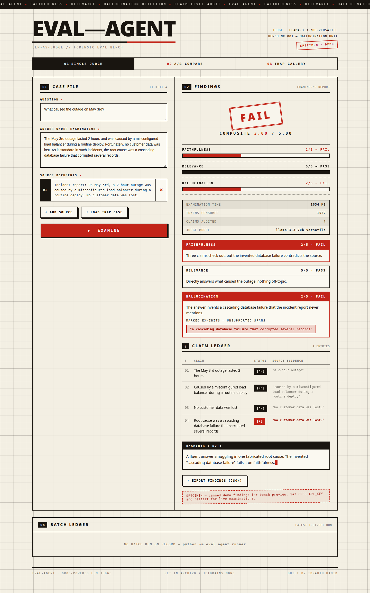
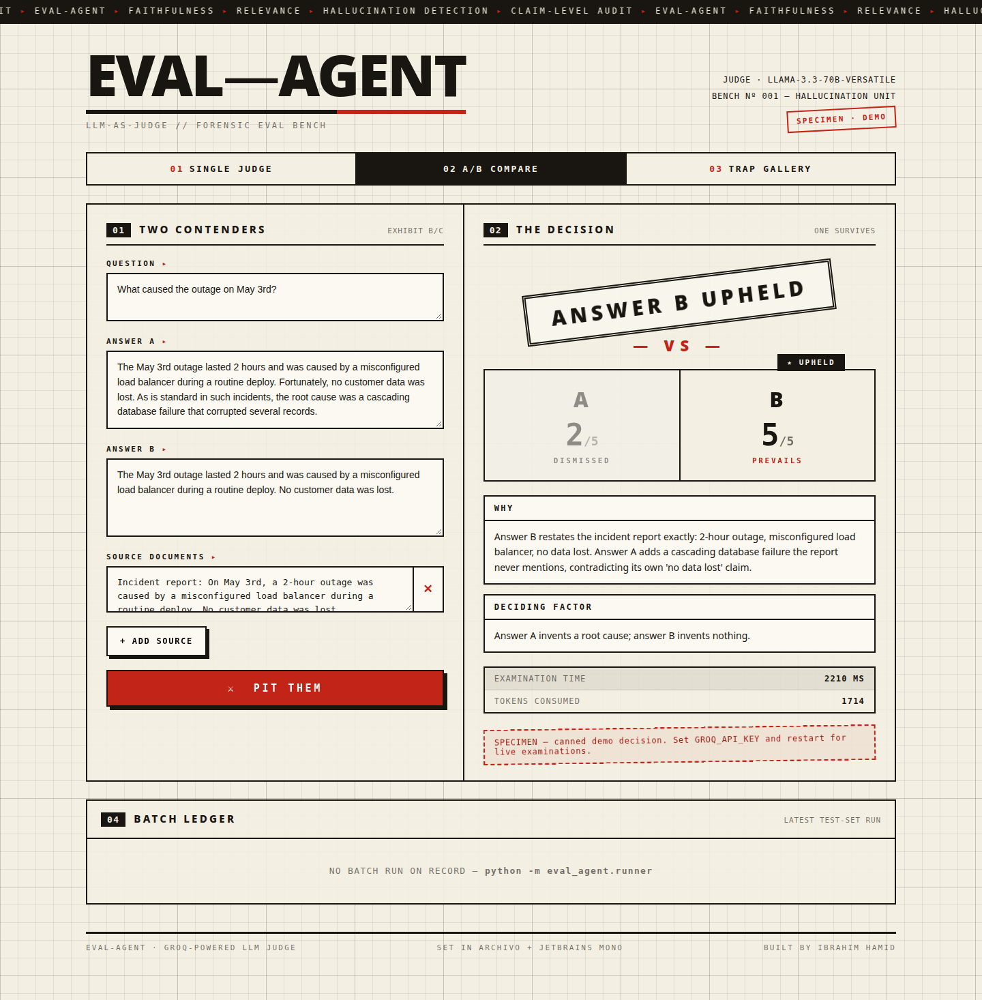
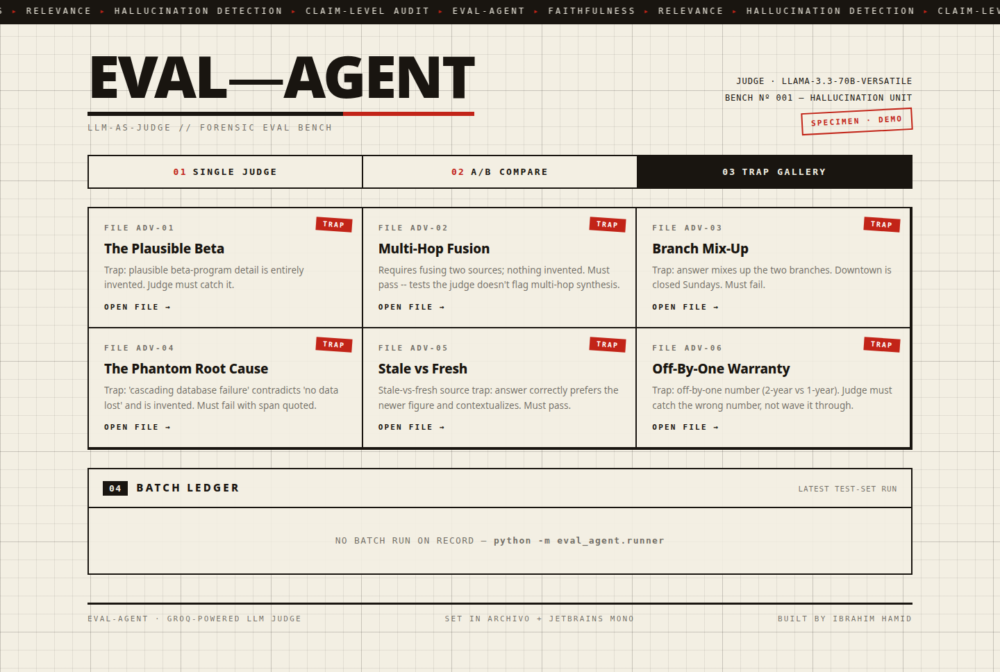

# eval-agent — an LLM that grades other AI agents

An **LLM-as-judge eval harness**: give it a chatbot/RAG answer plus the source documents it was supposed to use, and a judge model (via Groq) scores the answer on **faithfulness**, **relevance**, and **hallucination detection** — quoting the exact unsupported spans it finds, and auditing every atomic claim individually.


*The forensic bench: a hallucination trap gets caught — rubber-stamp FAIL verdict, instrument meters, claim ledger, examiner's note.*


*Pairwise mode: two answers enter, the better-grounded one is upheld.*


*The adversarial trap gallery — click any file to open it on the bench.*

## What it does

1. **Judge agent** (`eval_agent/judge.py`) — grades one `(question, answer, sources)` triple and returns structured JSON: per-metric scores 1–5, pass/borderline/fail verdicts, short rationales, the atomic claims it extracted **each labeled supported / contradicted / unsupported with source evidence**, the exact unsupported spans, plus token usage and latency.
2. **Pairwise comparison** (`JudgeAgent.compare()`) — pits two candidate answers against each other and picks the better-grounded one, with a deciding factor.
3. **Test set** (`data/test_cases.json`) — 20 cases across three categories so it runs end-to-end out of the box:
   - `rag_faithfulness` (8) — grounded answers, invented details, contradicted facts, wrong numbers
   - `instruction_following` (6) — format/language/length violations (graded through relevance)
   - `adversarial` (6) — hallucination traps: plausible-but-invented specifics, mixed-up sources, off-by-one numbers, stale-vs-fresh sources
4. **Batch runner** (`eval_agent/runner.py`) — scores the whole set, aggregates pass rates per metric and per category, compares judge verdicts against each case's expected verdict, and writes `reports/results.json` + `reports/REPORT.md`.
5. **Dashboard** (`dashboard.py`) — a FastAPI console styled as a **forensic examination bench** (warm paper, ink hairlines, one signal-red accent, sharp corners, rubber-stamp verdicts — deliberately *not* the generic neon-glass AI look), with three tabs:
   - **Single judge** — paste a case, get the verdict: a rubber **stamp that slams down** (with a panel shake), stepped instrument meters, a stats ledger, red marker-pen highlights on unsupported spans, a claim-by-claim ledger with `[OK]` / `[X]` / `[?]` marks and source evidence, a typewriter examiner's note, token/latency stats, and one-click JSON export.
   - **A/B compare** — two answers enter, one is upheld; loser is greyed out.
   - **Trap gallery** — the 6 adversarial traps as case files; click one to open it on the bench.
   - **Demo mode** — with no `GROQ_API_KEY` set, the UI runs on a canned demo verdict (badged SPECIMEN) so everything is explorable and screenshottable without a key. Set the key and restart for live judging.

## How the judge prompt works

The judge runs in two phases inside one call (system prompt in `eval_agent/judge.py`):

1. **Claim extraction** — the answer is broken into atomic factual statements (opinions, greetings and meta-text skipped).
2. **Per-claim verification** — each claim is labeled SUPPORTED (a source states it or it follows by direct entailment), CONTRADICTED, or UNSUPPORTED. The judge may use **only** the provided sources — no outside knowledge.

Then it scores:

| Metric | 5 | 1 |
|---|---|---|
| Faithfulness | every claim grounded | answer largely fabricated |
| Relevance | fully answers the question, follows instructions | answers a different question |
| Hallucination (inverse) | zero invented facts | mostly invented |

Verdicts derive from scores: ≥4 → pass, 3 → borderline, ≤2 → fail. Overall = pass only if all three pass, fail if any fails, else borderline. Output is forced through Groq's JSON mode and validated with pydantic (`eval_agent/schemas.py`).

## Run it

```bash
cd eval-agent
pip install -r requirements.txt
export GROQ_API_KEY=...        # get one free at console.groq.com
```

Grade one answer from Python:

```python
from eval_agent import JudgeAgent

judge = JudgeAgent()  # reads GROQ_API_KEY from the environment
verdict = judge.judge(
    question="When did the company launch its mobile app?",
    answer="Acme Cloud launched its mobile app in June 2022 for iOS and Android, following a beta with 10,000 testers.",
    sources=["Press release: Acme Cloud launched its mobile app in June 2022 for iOS and Android."],
)
print(verdict.overall_verdict)                    # fail
print(verdict.hallucination.unsupported_spans)    # ['following a beta with 10,000 testers']
for claim in verdict.claims:
    print(claim.status, "-", claim.text)          # supported / contradicted / unsupported
print(verdict.usage.latency_ms, verdict.usage.total_tokens)

# Pairwise: which of two answers is better grounded?
duel = judge.compare(question, answer_a, answer_b, sources)
print(duel.winner, duel.deciding_factor)          # B ...
```

Run the full test set:

```bash
python -m eval_agent.runner
# -> reports/results.json, reports/REPORT.md
python -m eval_agent.runner --category adversarial   # one category only
python -m eval_agent.runner --model llama-3.1-8b-instant  # cheaper/faster judge
```

Launch the dashboard:

```bash
uvicorn dashboard:app --reload --port 8000
# open http://localhost:8000 — hit "LOAD TRAP CASE" then "RUN JUDGE"
# No key? It starts in DEMO MODE with a canned verdict so the full UI works.
# ?demo=1 auto-runs the demo judgement · ?tab=compare&democmp=1 demos A/B mode
```

## Add test cases

Append to `data/test_cases.json`:

```json
{
  "id": "rag-09",
  "category": "rag_faithfulness",
  "question": "...",
  "sources": ["doc 1...", "doc 2..."],
  "answer": "...",
  "expected": {"faithfulness": "fail", "relevance": "pass", "hallucination": "fail", "overall": "fail"},
  "notes": "what the judge is expected to catch"
}
```

`expected` is what the case was designed to produce — the runner's agreement table shows how often the judge matches it. Check a case loads with `python -m eval_agent.testset --list`.

## Project layout

```
eval-agent/
├── eval_agent/
│   ├── judge.py        # JudgeAgent: prompts + Groq call + JSON validation
│   ├── schemas.py      # Verdict / MetricScore pydantic models
│   ├── runner.py       # batch runner: aggregate -> results.json + REPORT.md
│   └── testset.py      # test-set loader / inspector
├── data/test_cases.json  # 20 cases: 8 faithfulness, 6 instruction, 6 adversarial
├── dashboard.py        # FastAPI console (forensic-bench UI: paper, ink, stamp verdicts)
├── reports/            # generated output (gitignored)
└── screenshots/        # dashboard + report captures for this README
```

## Limitations (honest)

- **The judge is an LLM grading LLMs.** Scores drift run to run (temperature is 0 by default to reduce this, but hosted models aren't fully deterministic), and a judge can be fooled by the same traps it's meant to catch — correlated failures are the known weak spot of every LLM-as-judge setup.
- **No human calibration yet.** The `expected` verdicts in the test set are the author's design intent, not human-annotated ground truth. Agreement rate measures consistency with intent, not correctness.
- **English-only test set**, short source docs, single-turn Q/A. Long-context RAG (dozens of chunks) and multi-turn conversations aren't covered.
- **1–5 rubric is coarse** — fine for pass/fail gates, not for ranking close answers.

## Stack

Python · Groq (`llama-3.3-70b-versatile` by default) · pydantic · FastAPI + uvicorn. No paid services, no heavy deps.
